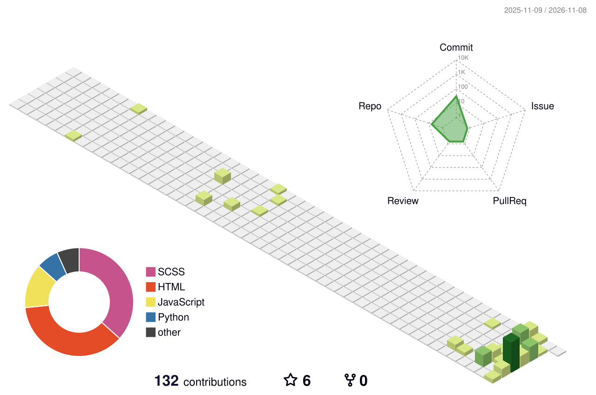

### Jiaxi (Jay) Liu

Ph.D. candidate in Civil and Environmental Engineering at the University of Wisconsin–Madison, working on calibrated safety testing and vision-language models for autonomous driving. Homepage: [hhjj233.github.io](https://hhjj233.github.io)

<picture>
  <source media="(prefers-color-scheme: dark)" srcset="./profile-3d-contrib/profile-night-green.svg" />
  
</picture>
